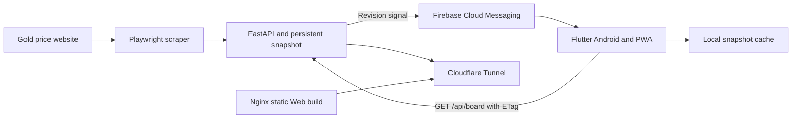

# Thai Gold View


A Flutter application for tracking Thai gold prices, reviewing price history, and calculating gold values. The project connects a mobile and PWA frontend to a Python scraping API running on an Ubuntu home server.

**[Live Demo](https://thaigoldview.com) · [Live API Sample](https://api.thaigoldview.com/api/board) · [Backend Repository](https://github.com/iceswift/aurum-thai)**

## Project overview

Thai Gold View brings price information, history, charts, and a calculator into one application. Its engineering focus is keeping data consistent across screens while avoiding duplicate requests and unnecessary transfers.

| Layer | Technology |
| --- | --- |
| Application | Flutter, Dart, Android, Progressive Web App |
| Client state and caching | Shared data repository, local persistence, revision-aware refresh |
| Backend | Python, FastAPI, asynchronous Playwright scraping |
| Notifications | Firebase Cloud Messaging and a Web service worker |
| Hosting | Ubuntu home server, Docker, Nginx, Cloudflare Tunnel |

## Engineering highlights

- **Consistent screen data:** prices, history, and calculator data flow through a shared board repository rather than independent page requests.
- **Request coordination:** concurrent refreshes share a request, and ETag support lets the API return `304 Not Modified` when the snapshot has not changed.
- **Cached access:** the latest snapshot is persisted locally and restored when the application starts.
- **Push-driven refresh:** FCM carries a revision signal; the application retrieves the authoritative snapshot from the API.
- **Production deployment:** Web builds are published into separate release directories with a previous release available for rollback.

## System architecture



## Selected engineering decisions

| Problem | Approach |
| --- | --- |
| Several screens could display different price snapshots. | Centralize fetching and distribute one shared snapshot. |
| Polling unchanged data wastes bandwidth. | Compare server revisions and use conditional requests with ETags. |
| A push payload can become outdated before it is opened. | Use push as a refresh signal and fetch prices from the API. |
| A day change triggered a misleading midnight price alert. | Persist market-status revisions without broadcasting a price push, and require an explicit visibility flag in the Web worker. |
| Embedded Web ad surfaces interfered with touch input. | Disable Web banner ads while keeping the mobile implementation separate. |

## Scope and limitations

Price freshness depends on the source website and the Backend scraping schedule; this is not a streaming market feed. Local cache supports viewing the last saved snapshot when a refresh is unavailable. Shop scraping is currently disabled on the production Backend. Availability depends on the home server and its Internet connection.

## Code guide

- [`lib/repositories/`](lib/repositories/): shared snapshot fetching and refresh coordination.
- [`lib/services/fcm_service.dart`](lib/services/fcm_service.dart): Firebase messaging and Web token registration.
- [`web/firebase-messaging-sw.js`](web/firebase-messaging-sw.js): browser push and notification-click handling.
- [`test/`](test/): snapshot parsing, caching, deduplication, and conditional-refresh tests.

## Data flow

The app reads `https://api.thaigoldview.com/api/board` through a shared repository. It caches the latest board snapshot, deduplicates concurrent requests, uses ETags for unchanged data, and refreshes when the app resumes or receives an FCM signal.

```text
Backend snapshot changes -> FCM data event -> /api/board -> local cache and shared state
```

The API is always the source of truth; FCM never contains trusted price data.

## Development and builds

```bash
flutter pub get
flutter test
flutter run -d chrome
flutter build apk --release
flutter build web --release
```

The PWA output is `build/web`.

## Web Push

The PWA registers `web/firebase-messaging-sw.js` at the domain root. A user enables notifications from Settings. iPhone and iPad users must first install the site to the Home Screen.

Web tokens are registered with `POST https://api.thaigoldview.com/api/push/subscribe`. Only Backend-marked price events with `user_visible: "true"` create a visible notification. Other data-only events keep open clients in sync silently, so midnight market-status changes cannot appear as price alerts.

Firebase Web config and the VAPID public key are public client configuration. Never include Firebase service-account credentials in this repository or in `build/web`.

## Home server PWA deployment

```text
/srv/thai-gold-view/web/
├── current -> releases/<git-short-sha>
├── releases/
└── deploy/
    ├── docker-compose.yml
    └── nginx/default.conf
```

```bash
flutter build web --release
# Upload build/web to /srv/thai-gold-view/web/releases/<git-short-sha>
ln -s releases/<git-short-sha> /srv/thai-gold-view/web/current.next
mv -Tf /srv/thai-gold-view/web/current.next /srv/thai-gold-view/web/current
cd /srv/thai-gold-view/web/deploy
docker compose up -d --force-recreate thai-gold-web
```

The Nginx bind mount resolves `current` at container startup, so recreate only `thai-gold-web` after switching release. This does not restart `gold-api`.

## Web verification and rollback

```bash
curl -I https://thaigoldview.com/
curl -I https://thaigoldview.com/manifest.json
curl -I https://thaigoldview.com/firebase-messaging-sw.js
curl -I https://api.thaigoldview.com/health
```

`index.html`, `flutter_bootstrap.js`, `flutter_service_worker.js`, `firebase-messaging-sw.js`, and `manifest.json` must not be cached long-term. To roll back, repoint `current` to a previous `releases/<sha>` directory and recreate only `thai-gold-web`.

See [`docs/PWA_DEPLOYMENT.md`](docs/PWA_DEPLOYMENT.md) for Firebase and hosting details.
